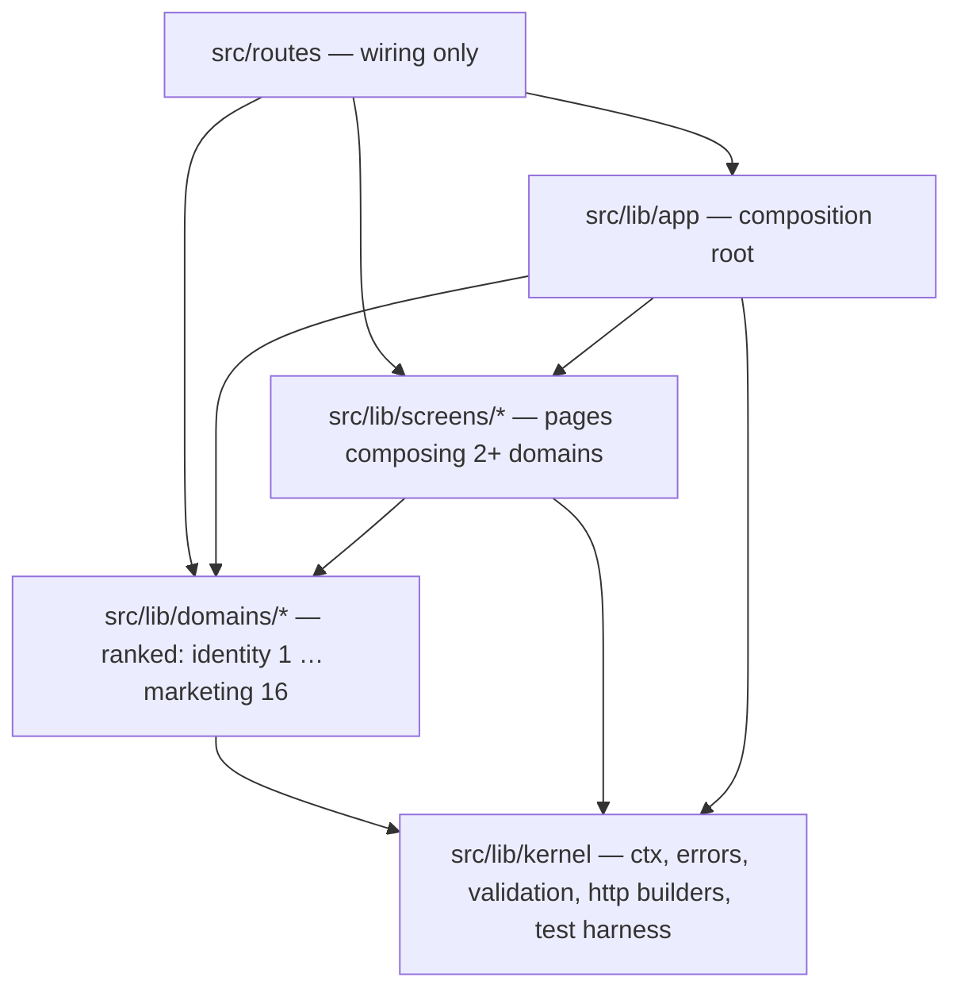

# Architecture (v2)

How the website and server are organised after the rewrite. Covers the design choices, where code lives, how a request flows, and where to read next. The Android app (`apps/android`) is outside this design; it is a client of the `/api` contract described here.

- Rules enforced by `npm run arch`: [rules.md](rules.md)
- Naming, signatures, errors, UI patterns, and the "one home per concept" table: [conventions.md](conventions.md)
- Tests and gates: [testing.md](testing.md)
- Module catalog (generated): [modules.md](modules.md)
- Decisions, with their reasons: [docs/adr/](../adr/)

## Design choices

| # | Choice | Why | ADR |
|---|---|---|---|
| 1 | **Rebuild in place, one module at a time**, on branch `rewrite/v2`. Each module is redesigned from its behaviour inventory: internals, page data, components and tests are rewritten, and legacy code is copied only where it is correct and pure. Only external contracts are preserved (the `/api` wire, the schema, CONTEXT.md rules, the approved look). Every step leaves the app green and deployable. | A big-bang rewrite would have to re-find, all at once, the behaviour pinned by about 57k lines of tests, by the production database and by the Android contract. Module-by-module keeps each rebuild small, checkable and reversible, without keeping the bad parts. | [0003](../adr/0003-rewrite-in-place-module-by-module.md) |
| 2 | **Keep the stack, the schema and the wire.** SvelteKit 2, Svelte 5, Drizzle, Postgres on Neon, Vercel. Table names, migration names and every `/api/**` response stay the same. | The problems are structural, not caused by the framework. The Android app and TaskFocus read the API byte for byte, and migration file names are the production tracking keys. | [0008](../adr/0008-keep-stack-schema-and-wire.md) |
| 3 | **Vertical modules with a dependency rank.** `kernel` → 16 ranked domains → 6 screens → `app`. Modules are imported only through their public entry files. | One folder answers "where is X": rules, SQL, HTTP, UI and tests for one concept live together. Ranks make cycles impossible, and the rules are machine-checked so a weaker agent can't drift. | [0004](../adr/0004-vertical-modules-ranked-dependencies.md) |
| 4 | **Dependencies arrive through `ctx`.** Every service is `fn(ctx, actor, input)`. Real adapters are chosen once, in `src/lib/app`. | Today, a test of any server code must mock the `db` singleton and the clock (26+ suites of stub boilerplate). With `ctx`, tests swap dependencies through a real interface and need no `vi.mock`. | [0005](../adr/0005-explicit-dependencies-through-ctx.md) |
| 5 | **One boundary builder per request type.** `endpoint`, `pageLoad` and `formAction`, with zod schemas. Route files are wiring only. | Auth guards, input checks and error shapes were hand-copied 36+ times in 4 styles. Writing them once removes the copies and makes HTTP behaviour testable without a server. | [0006](../adr/0006-one-boundary-builder-zod-contracts.md) |
| 6 | **Files named by role.** `<module>.<topic>.<role>[.server].ts`, where role is rules, contract, repo, service, http, api, state or fixtures. SQL lives only in repos. Rules are pure and take "now" as a parameter. | The file name tells an agent what a file may contain and which kind of test covers it. `grep repo.server` finds every query. | [conventions.md](conventions.md#file-roles) |
| 7 | **Tests at seams, fast by design; legacy tests are reference, not a gate.** Rules get table tests in node. Repos and services get rollback tests on a database rebuilt from `sql/migrations` on every run. `/api` gets golden contract tests, written against the legacy handler first. UI gets state classes tested in node, a few component tests, and a visual check. | Each layer can be checked on its own in seconds (`npm run test:mod -- <module>`). The goldens prove a rebuild changed nothing a client can see. The legacy suite (over 15 minutes, mostly jsdom and mocks) only runs where a change touches legacy files. | [testing.md](testing.md) |
| 8 | **Svelte 5 runes only.** Page state lives in `*.state.svelte.ts` classes that take an api client. Components get data and callbacks. Components never call `fetch`. | Two component generations and 43 `fetch` calls inside components are what make today's pages (up to 1,090 lines) hard to test or change. | [conventions.md](conventions.md#ui) |
| 9 | **Deduplicate by "one home per concept"**, backed by unique file names and unique exported names (R10/R11). | Grep finds exactly one definition, so a concept can't quietly fork again (5 date formatters, 3 recurrence steppers and 8 task shapes exist today). | [conventions.md](conventions.md#one-home-per-concept) |
| 10 | **Docs are code.** Each module has a README listing every file (what, why, test), checked by `npm run docs:check`. AGENTS.md is a short hub. Old tickets are archived. | An agent reads a few hundred lines to learn a module instead of grepping a 2,500-line file, and the docs can't silently rot. | [0009](../adr/0009-docs-are-code.md) |

## Layers



- A domain imports only domains with a **lower** rank (rank table: [modules.md](modules.md)). When a lower module needs to "call up", invert the dependency: the caller passes a callback, a ctx port, or a Svelte snippet.
- A screen imports domains and never another screen.
- Only `app` imports legacy code, and only as bridges that are listed with the task that removes them.

## Anatomy of a domain module

```text
src/lib/domains/tasks/
  README.md                      what/why/test for every file (docs:check)
  index.ts                       public isomorphic entry: contract types, rules, client api
  index.server.ts                public server entry: services + http handlers
  tasks.contract.ts              zod schemas for request/response bodies = the wire format
  tasks.cursor.rules.ts          pure rules (Recurring Task cursor), "now" passed in
  tasks.cursor.rules.test.ts     table tests
  tasks.repo.server.ts           every SQL query for tasks tables (only file importing tables)
  tasks.repo.db.test.ts          rollback tests on real Postgres
  tasks.service.server.ts        use-cases: (ctx, actor, input) → result; authz + orchestration
  tasks.service.db.test.ts
  tasks.http.server.ts           endpoint()/pageLoad()/formAction() definitions
  tasks.http.db.test.ts          golden contract tests (status + body per endpoint)
  tasks.api.ts                   browser client for the endpoints (typed by the contract)
  tasks.list.state.svelte.ts     client state machine (runes), takes the api as a dependency
  tasks.fixtures.server.ts       row builders for tests
  ui/index.ts                    public components
  ui/TaskRow.svelte              components: data + callbacks in, events out
  ui/TaskRow.svelte.test.ts
```

Route files only point at the module's exports:

```ts
// src/routes/api/tasks/+server.ts
import { listTasks, createTask } from '$lib/domains/tasks/index.server';
export const GET = listTasks.handler;
export const POST = createTask.handler;
```

## A request

```mermaid
sequenceDiagram
  participant K as SvelteKit
  participant H as hooks.server.ts
  participant E as endpoint() (kernel)
  participant S as tasks.service
  participant R as tasks.repo
  K->>H: request
  H->>H: locals.ctx = appCtx; resolve session or Bearer → locals.actor
  H->>E: route handler
  E->>E: auth mode, rate limit, zod-parse query/body/params
  E->>S: handle({ ctx, actor, body })
  S->>R: repo(ctx.db, …) inside withTx when atomic
  R-->>S: rows
  S-->>E: result or throw AppError
  E-->>K: ok/created JSON · AppError → status + {error} · other → 500 + fault filed
```

## Where things stand

The rewrite is in progress. Track it in [docs/rewrite/LEDGER.md](../rewrite/LEDGER.md) and with `npm run census`. Code that hasn't been ported yet still lives in the legacy folders (`src/lib/server`, `src/lib/utils`, `src/lib/components`, …). The port sheet for each module ([docs/rewrite/modules/](../rewrite/modules/)) lists the legacy files that module will absorb.
